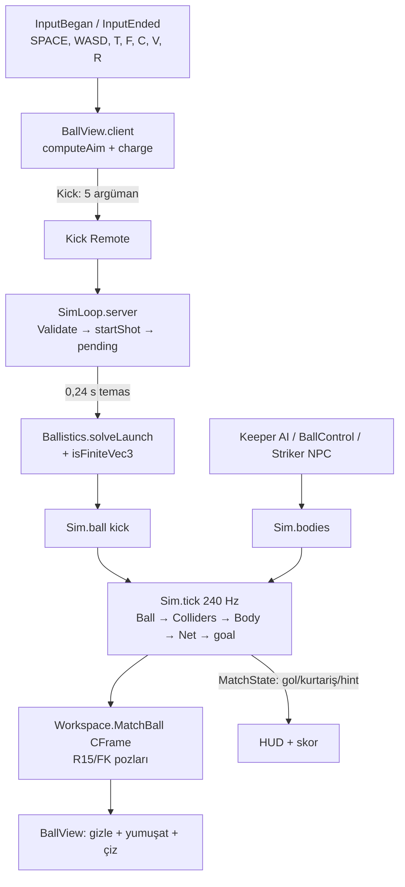

# FootballSim — Tüm Sistem Analizi

**Tarih:** 2026-11-18 · **Dal:** `arena/e929cb5f-football-sim` · **Taban:** `70de691`
**Kapsam:** `src/` (28 modül), `install/`, `preview/`, `tools/`, `default.project.json`, `README.md`
**Yöntem:** kaynak okuması + çalıştırılabilir doğrulama (`npm test`, `npm run verify`, mutasyon alt kümesi) + hedefli hesap/kullanım analizi

---

## 1. Yönetici özeti

Proje, Roblox için **sunucu otoriteli, deterministik, 240 Hz kendi fizik motorunu** kullanan yarım saha futbol simülasyonudur. Top Roblox fiziğine bırakılmaz; aerodinamik (drag + Magnus), analitik zemin teması, sürekli direk çarpışması, ağ sönümlemesi ve prosedürel FK animasyonları kodla üretilir. Dağıtım iki yoldur: tek dosyalık Command Bar kurulumu (`install/FootballSim_Install.lua`, 189.412 karakter) veya Rojo.

**Genel değerlendirme: sistem çalışır durumda ve iddialarının büyük bölümü çalıştırılabilir kanıtla destekleniyor.** 146 test / 15 grup geçiyor; 13/13 entegrasyon kapısı yeşil; doğrulayıcının kör olmadığını göstermek için seçilen mutasyonlar da yakalandı. Oyuncu animasyonu arızasının kök nedeni bu turda bulunup düzeltildi (bkz. bölüm 9). Ancak kaynak incelemesinde **3 öncelikli (P0) işlevsel/otorite açığı**, **5 orta (P1) tutarlılık/kalite açığı** ve bir dizi ölü API / belge abartısı bulundu.

| Öncelik | Bulgu | Kısa etki |
|---|---|---|
| **P0-1** | Düşük güçte şut `Ballistics.solveLaunch` → `nil` döndürüyor; temas anında topa hız yazılmıyor ve oyuncuya **hiçbir geri bildirim gitmiyor** | Kısa basışta animasyon oynar, top kıpırdamaz |
| **P0-2** | Yarım sahada fiziksel engeller/gol algılama **iki kale** için kurulu; görsel kale, ağ ve kaleci yalnız `+x` tarafında | `-x` yönüne giden top görünmez kaleye "gol" olabilir |
| **P0-3** | `ResetBall` remote'u oyuncu doğrulaması olmadan **herkese** açık, hız sınırı global | Herhangi bir istemci maçı 0,5 s aralıklarla sıfırlayabilir / sıfırlamayı bloke edebilir |
| **P1-1** | Yürüyüş fazı `t * anlık_hız` ile hesaplanıyor | Hız değişince adım fazı sıçrar, ayak kayması/titreme |
| **P1-2** | Kaleci animasyonu 0,3–1,0 m uzanırken fizik gövdesi yalnız **+0,14 m** büyür | Görsel kurtarış ile fizik ayrışır |
| **P1-3** | `Body.collide` sürekli (swept) test değil, anlık çakışma testi | Yorumlardaki "adım içi hareket doğrusu" iddiası kodla örtüşmüyor |
| **P1-4** | `MatchState`RemoteEvent ile **tüm istemcilere** (`FireAllClients`) gönderiliyor | Çok oyunculuda bir oyuncunun şut hatası herkesin HUD'una düşer |
| **P1-5** | Şut geri bildirimi istek anında veriliyor; temas anındaki balistik başarısızlığı bildirilmiyor | P0-1'in görünürlük kısmı |

---

## 2. Sistem haritası

### 2.1 Katmanlar

| Katman | Dosyalar | Görev | Roblox konumu |
|---|---|---|---|
| Yapılandırma | `Config.luau` | SI birimleri, FIFA ölçüleri, tüm parametreler | `ReplicatedStorage.Shared` |
| Çekirdek | `Core/Vec3`, `Rng`, `Aero`, `Ballistics`, `Validate` | float64 vektör, deterministik PRNG, aerodinamik, hedef çözümü, girdi beyaz listesi | `Shared` |
| Fizik | `Physics/Ball`, `Pitch`, `Colliders`, `Net`, `Body` | top entegrasyonu, saha olayları, direk kapsülleri, ağ, gövde çarpışması | `Shared` |
| Oyuncu | `Player/Locomotion`, `BallControl`, `Keeper`, `Striker` | hareket, top sürme/şut, kaleci AI, opsiyonel demo şutçusu | `Shared` |
| Animasyon | `Anim/Rig`, `PartRig`, `KickAnim`, `KeeperAnim`, `WalkCycle`, `PlayerPose`, `HumanoidPose`, `Pose`, `Ease` | FK iskelet, adaptif pozlar, R15/R6 Motor6D sürümü | `Shared` |
| Dünya | `World/SceneBuilder.luau` | saha, çizgiler, kale, ağ, stadyum, ışık, spawn | `Shared` |
| Orkestrasyon | `Sim.luau` | sabit adım, akümülatör, gol tespiti, gövde/ağ entegrasyonu | `Shared` |
| Sunucu | `SimLoop.server.luau` | otorite, remotes, AI, AI/oyuncu şutları, skor, görsel yazım | `ServerScriptService.Server` |
| İstemci | `BallView.client.luau` | top yumuşatma, kamera kipleri, nişan, HUD, güç barı, yerel poz | `StarterPlayerScripts.Client` |
| Dağıtım | `installer_lib.js`, `installer/bootstrap.lua`, `default.project.json` | tek dosya üretimi / Rojo eşlemesi | — |
| Doğrulama | `spec.luau`, `verify.js`, `verify_mutations.js`, `trace.luau`, `anim_trace.luau`, `serve.js` | test, 13 kapı, mutasyon testi, JSON izleri, önizleme | geliştirme aracı |

### 2.2 Çalışma zamanı akışı



**Kritik zamanlama:** şut isteği ile topun ayrılması arasında `KickAnim.CONTACT_TIME = 0,24 s` var; istemci bu pencerede pozu **yazmaz** ("tek yazar" kuralı), sunucu yazar. Sahadeki diğer anlarda yürüyüş/duruş pozunu istemci (kendi karakteri), sunucu (diğerleri) sürer.

### 2.3 Test mimarisi

`runner.js` tüm `.luau` dosyalarını tek Lua paketine gömer; `shim.luau` `script.Parent`/`require` semantiğini, `roblox_mock.luau` Roblox API'sini taklit eder; `fengari` (Lua 5.3) üzerinde `spec.luau` çalışır. Aynı paket `--trace` ve `--anim` kiplerinde gerçek motor çıktısını `preview/*.json` üretir. Yani tarayıcı önizlemeleri elle çizilmiş animasyon **değil**, motorun kaydıdır.

---

## 3. Çalıştırılmış doğrulama kanıtları

| Komut | Sonuç |
|---|---|
| `npm install` | 5 paket kuruldu (`fengari-node-cli`) |
| `npm test` | **GEÇEN 146 / BAŞARISIZ 0**, 15 grup, kurulum senkron denetimi dahil |
| `npm run verify` | **13/13 kapı geçti**, 0 uyarı; 30 kaynak derlendi; 146 test; 6 fizik senaryosu/635 nokta; 16 anim sahnesi/481 kare |
| `MUTATE_ONLY=M47,M48,M49,M50 npm run verify:mutate` | 4/4 kusur yakalandı (`RenderStepped`, track durdurma, `AnimationConstraint` desteği, `Stepped` zamanlaması); dosyalar geri yüklendi |

Not: 54 kusurluk tam mutasyon koşusu (~28 dk) bu analizde çalıştırılmadı; yalnızca temsili alt kümeler (5/5, 4/4 ve 4/4) doğrulandı.

---

## 4. Fizik ve oynanış modeli

- **Ölçek:** 1 m = 3,5714 stud; saha 105 × 68 m, kale 7,32 × 2,44 m, top 0,11 m / 0,43 kg.
- **Entegrasyon:** 240 Hz sabit adım; trapez (velocity-Verlet) `p' = p + (v+v')/2·dt`; 60 Hz ile 240 Hz aynı yörünge (test var).
- **Hava:** `a = -0,5ρA C_d(v)|v|v/m` ve Magnus `0,5ρA C_l v²(ω̂×v̂)/m`. `C_d` 12 m/s civarında 0,47 → 0,25'e düşer (drag crisis); terminal hız ~26,9 m/s.
- **Zemin:** `y(t)=r` denkleminin analitik kökü; Coulomb sürtünmesi + topspin/backspin sekme kuplajı; yuvarlanma direnci 0,06·g.
- **Çarpışma:** direk/üst direk için doğru-parça–doğru-parça en yakın nokta (sürekli test); gövde için dikey kapsül; top–ağ için üstel sönüm (`exp(-7dt)`) + yay-sönümleyici `sag` (max 0,38 m).
- **Oyuncı–top:** 0,34 s dokunuş aralığı, `v_top = v_oyuncu + 0,5·a·t` çözümü; sprintte dokunuş kaçar; sahiplik bandı 3,20 m / 0,60 s; şut tamponu 6,00 m / 0,75 s; nişan hatası σ ≈ 2,2°.
- **Kaleci:** 120 Hz tahmin kopyası, 0,12 s tepki, `reachZ = 3,15 m`, dalış hızı 8,5 m/s; gövde fiziksel engel.
- **Bilinen model sınırı:** balistik çözücü drag'ı ihmal eder → uzun şutlar ~%15 kısa düşer (README'de açıkça yazılı).

---

## 5. Güçlü yanlar

1. **Determinizm gerçekten tasarım hedefi:** float64 `Vec3`, Park–Miller RNG, sabit adım ve tohum testleri; tick gruplama ve FPS bağımsızlığı ayrıca test ediliyor.
2. **Sunucu otoritesi ve girdi sertleştirme:** `Validate` beyaz listesi NaN/inf/tablo/string saldırılarını varsayılan değerlere indirgiyor; her balistik çıkışı `isFiniteVec3` ile korunuyor.
3. **Sessiz red bilinçli olarak ortadan kaldırılmış:** sahiplik + tampon + `hint` mekanizması, "topa yaklaşınca şut çıkmıyor" şikâyetini hem kural hem geri bildirim düzeyinde çözüyor (P0-1 istisnası dışında).
4. **Varlıksız sunum:** hiç yayınlanmış Asset/Animation yok; aynı `Rig.solve` hem oyunda hem tarayıcı izleyicisinde kullanılıyor; R15 + R6 desteği ve `Animate` çakışmasının farkında olunması değerli.
5. **Doğrulama kültürü:** statik API/sınır/kurulum/Rojo/remote denetimleri, canlı E2E testleri, gerçek HTTP duman testi ve doğrulayıcının kendisini test eden mutasyon aracı.
6. **Tek kurulum ve idempotence:** 28 modül gömülü tek dosya; tekrar çalıştırınca scriptler/sahne çoğalmıyor; Rojo alternatifi mevcut.
7. **Belge disiplini:** README, test sayıları ve kapı iddiaları otomatik denetleniyor; bilinen sınırlar dürüstçe listelenmiş.

---

## 6. Bulgular ve önerilen düzeltmeler

### P0-1 — Düşük güçte şut sessizçe kayboluyor

**Kanıt:** `SimLoop.server.luau:397-407` temas anında `Ballistics.solveLaunch(...)` çağırır; `disc < 0` ise `nil` döner (`Ballistics.luau:34-38`), `isFiniteVec3(nil)` false olur ve `if` bloğu boşa geçer. `startShot` sırasında yapılan `shotHint` yalnızca menzil/kilit kontrollerini kapsar; temas anında hata bildirimi yoktur.

**Hesap:** başlangıçtopu `x = 21 m`, kale `x = 52,5 m` → `R ≈ 31,5 m`. `minKickSpeed = 13 m/s` için disk `-6,99e4` (negatif). Eşik **17,83 m/s ≈ charge 0,268 ≈ 0,24 s basış**. Yani ilk çeyrek saniyeden kısa basışlarda top hiç fırlamaz; oyuncu şut animasyonunu görür, HUD sessiz kalır. Testler daima ~1 s basış kullandığı için (`spec.luau:2743`, `:3116`) bu durum kapsanmıyor.

**Öneri:** `solveLaunch` başarısız olduğunda hızı menzile göre asgariye yükseltip yeniden çöz (veya yüksek yay/iteratif çözüm kullan); hâlâ başarısızsa `shotHint("shotRejected", ...)` gönder. `charge = 0,1` için E2E test ekle.

### P0-2 — Yarım sahada hayalet kale

**Kanıt:** `Pitch.buildObstacles` (`Pitch.luau:82-101`) her iki kale için direk üretir; `Pitch.goalCrossed` (`:44-60`) `-1` tarafını da gol sayar. Buna karşılık `SimLoop` yalnız `Net.new(Config, scene.goalSide)` ve tek `Keeper` kurar; `SceneBuilder.build({half=true})` görsel kaleyi de yalnız `+x`'e koyar.

**Etki:** kaleci kurtarışıyla veya gövde çarpışmasıyla `-x` yönüne giden top, görünmez bir kale çizgisini geçtiğinde `stats.goals` artar ve 2,4 s sıfırlama başlar.

**Öneri:** `Sim.new({ half, goalSide })` taşı; `goalCrossed`'e `allowedSide` parametresi ekle ya da `-x` geçişini "oyun dışı" olarak sınıflandır.

### P0-3 — Sıfırlama remote'unda yetkilendirme yok

**Kanıt:** `SimLoop.server.luau:291-299`: `resetRemote.OnServerEvent:Connect(function() ... resetBall() end)`. Ne `player` parametresi ne mesafe ne de oyuncu başına hız sınırı var; `lastResetAt` **global**.

**Etki:** herhangi bir istemci topu istediği zaman (0,5 s'de bir) sıfırlayabilir; aynı değişken diğer oyuncuların sıfırlama isteklerini de engeller.

**Öneri:** `OnServerEvent(function(player, ...)`, oyuncu başına `lastResetAt[player]`, topa yakınlık veya oyun yöneticisi kontrolü ekle.

### P1-1 — Adım fazı hız değişiminde sıçrıyor

**Kanıt:** `PlayerPose.phaseAt(t, speed) = (t·speed / STRIDE) % 1` (`PlayerPose.luau:52-61`). Faz, birikmiş mesafe yerine "mutlak zaman × anlık hız" ile hesaplanıyor. `t = 10 s`'de ivme 6,5 m/s² ve `dt = 1/60` ise Δv ≈ 0,108 m/s → faz sıçraması ≈ `10·0,108/1,9 ≈ 0,57` döngü (~205°). Testler sabit hız kullanır (`spec.luau:1409-1417`).

**Öneri:** karakter başına birikmiş mesafe/`phase` durumu tut, her karede `phase += speed·dt/STRIDE` yap; sunucu ve istemci aynı yöntemi kullanmalı. Değişken hızlı test ekle.

### P1-2 — Kaleci görsel uzanması ile fizik gövdesi uyuşmuyor

**Kanıt:** `KeeperAnim.luau:63` görsel uzanmayı `0,30–1,0 m` olarak üretir; `Keeper.luau:176` fizik yarıçapına yalnız `diveReachBonus = 0,14 m` ekler. `KeeperAnim` başlığındaki "uzanma fiziksel gövdeye de uygulanır, görsel ile fizik ayrışmaz" ifadesi abartılıdır.

**Öneri:** dalışın zaman zarfına göre etkili yarıçap/el kapsülünü animasyonun `hand` konumlarından türet (PartRig çözümü zaten mevcut) ya da belgeyi "kısmi uzanma" olarak düzelt.

### P1-3 — Gövde çarpışması sürekli değil

**Kanıt:** `SimLoop.server.luau` yorumları "240 Hz, adım içi hareket doğrusu" der; `Body.collide` (`Body.luau:47-51`) ise yalnız `ball.pos` ile kapsül arasındaki **anlık** en yakın noktayı kullanır. `Colliders.resolve` gerçekten segment kullanır; `Body` kullanmaz. Ayrıca gövde konumları kare başına bir kez yazılır, 240 Hz alt adımlar arasında enterpolasyon edilmez.

**Etki:** 30 m/s top adım başına 0,125 m ilerler; yarıçap 0,53 m olduğu için bugün tünelleme olası değil, ancak hızlı yanal kaleci hareketi ve gelecek 11v11'de risk büyür.

**Öneri:** `Body.collide(ball, body, fromPos, prevBodyPos)` imzasıyla segment-kapsül testi ekle veya iddiayı "240 Hz diskret test" olarak düzelt.

### P1-4 — Hint tüm oyunculara gidiyor

**Kanıt:** `broadcastState` → `stateRemote:FireAllClients({..., hint = hint})`; `shotHint` tek oyuncunun hatasını bu kanalla yayınlar.

**Öneri:** `hint` için ayrı `FireClient(player, ...)` kullan; genel skor/gol olayları `FireAllClients` olarak kalsın.

### P1-5 — Temas anı başarısızlığı bildirilmiyor

P0-1 ile aynı kök: `shotHint` yalnız istek zamanında çağrılıyor. Balistik çözüm `nil` döndüğünde `pending[player]` yine `duration` sonunda sessizce siliniyor.

### P2 — Mimari temizlik ve doğruluk

- **Ölü API'ler:** `Config.MATCH` (yoksayılıyor), `Sim:interpolatedBall`, `SceneBuilder.resetBallPosition`, `Pitch.classifyOutOfPlay`, `Pitch.kickoffSpot/clampPosition/points`, `Keeper.evaluateIncoming`, `Body.reachDistance` (yalnız testte), `Pose.add/scale`, `Ball:predict`, `Rng:clone`, `touchSpeedFactor`. Ya yol haritasına bağlanmalı ya kaldırılmalı; `verify.js` "ölü dışa aktarım" denetimi yalnız modül `require` bağlamalarına bakıyor, bu fonksiyonları yakalamıyor.
- **`Pitch` çift yapılandırma:** `buildObstacles(cfg)` parametreyi kullanırken `goalCrossed`, `isInside` vb. modül seviyesindeki `P = Config.PITCH`'i kullanır. Özel cfg ile simüle eden testler iki farklı geometriye sessizce düşebilir.
- **Kurulum boyutu:** 189.412 karakter / 194.467 bayt tek dosya. Studio tarafındaki dize/Command Bar sınırlarına yakın; bir kez gerçek Studio'da doğrulanmalı (Rojo yolu zaten var).
- **Dil kapısı konservatif:** `verify.js:646-661` modern Luau'nun desteklediği `//`, `<<`, `&`, `|`, `+=`, `continue` gibi yapıları "Luau'da yok" gerekçesiyle yasaklıyor. Gerekçe kısmen eski; kural `--` test koşucusu Lua 5.3 ile uyumluluk adına korunuyorsa mesaj buna göre güncellenmeli.
- **İstemci varsayılanları:** `BallView` Config gelmezse sabit değerlere düşer; `verify.js` bazı anahtarları karşılaştırsa da (grup 12) tüm eşikler için tek kaynak garantisi yok.

---

## 7. Kapsam / yol haritası uyumu

| Adım | Durum | Gözlenen gerçeklik |
|---|---|---|
| 1 Top fiziği | Tamam | 240 Hz, drag/Magnus, sekme, direk; testli |
| 2 Sahne + tek kurulum | Tamam | Yarım saha + stadyum + ışık; 188 KB tek dosya; Rojo |
| 3 Top–oyuncu + file | Tamam | Dokunuş/sprint/trap/şut, ağ sönümü, kaleci AI; P0-1/P0-2 istisnaları |
| 4 Pas / oyun kurma | Yok | `Ballistics` altyapısı hazır, pas API'si yok |
| 5 Maç kuralları | Yok | `Config.MATCH` ve `Pitch.classifyOutOfPlay` taslak, kullanılmıyor |
| 6 11v11 / takım AI | Yok | `SceneBuilder` tam saha modu var; AI yok |
| 7 Ağ tahmini / lag compensation | Yok | İstemci yumuşatma var, prediction yok |
| 8 Sunum | Kısmi | FK animasyon + 3 kamera + HUD var; ses yok; P1-1/P1-2 görsel kaliteyi düşürüyor |

---

## 8. Önerilen aksiyon planı

1. **Şut güvenliği (P0-1, P1-5):** `solveLaunch` sarmalayıcısı + asgari hız kompanse + temas anında `hint` + düşük `charge` E2E testi.
2. **Tek kale doğruluğu (P0-2):** `Sim`/`Pitch` yarı saha bilgisini taşısın; ters kale gol sayılmasın.
3. **Remote yetkisi (P0-3):** `ResetBall` oyuncu bazlı hız sınırı ve yetki kontrolü.
4. **Animasyon sürekliliği (P1-1, P1-2):** birikmiş faz durumu; kaleci el kapsülünü pozdan türet.
5. **Fizik yorumları ile kod uyumu (P1-3):** swept gövde testi veya belge düzeltmesi.
6. **HUD hedefleme (P1-4):** `FireClient` ile oyuncuya özel hint.
7. **Temizlik (P2):** ölü API kaldırma, `Pitch` cfg tutarlılığı, kurulum boyutu doğrulaması, dil kapısı mesajı.

Her düzeltme sonrası `npm test && npm run verify` ve ilgili mutasyon vakası (`tools/verify_mutations.js`) birlikte koşulmalı; yeni davranışlar için `spec.luau` içinde koruma testi eklenmelidir.

---

## 9. Oyuncu animasyonu arızası — kök neden ve düzeltme (bu tur)

Kullanıcı "oyuncu animasyonu çalışmıyor" diye bildirdi. Testler yeşil olmasına
rağmen gerçek Roblox'ta pozların görünmemesinin **beş ayrı nedeni** vardı:

1. **Zamanlama (ana neden):** istemci `Motor6D.Transform` değerlerini
   `RenderStepped` içinde yazıyordu. Roblox `Animator`'ı her karede bu değerleri
   `PreAnimation` sonrası / `PreSimulation` öncesinde kendi pozlarıyla ezer
   (Roblox `Motor6D.Transform` dokümantasyonu). Poz artık **`RunService.PreSimulation`**
   içinde, animatordan SONRA yazılıyor (eski platformlarda `Stepped` yedeği);
   kamera/HUD/top yumuşatma `RenderStepped`'de kaldı.
2. **Zaten oynayan track'ler:** `Animate.Disabled = true` tek başına yeterli
   değil; çalışan `AnimationTrack`'ler `Animator` içinde yaşamaya devam eder.
   İstemci artık `Humanoid` ve `Animator` üzerindeki track'leri
   `GetPlayingAnimationTracks()` + `Stop(0)` ile durduruyor.
3. **Tek seferlik uygunluk kontrolü:** `CharacterAdded` anında `Motor6D` veya
   `Animate` henüz yok olabilir. `ChildAdded` dinleyicisi + 0,25 s periyodik
   kontrol ile geç yüklenen eklemler/Animate yakalanıyor; motor yokken varsayılan
   animasyon açık bırakılıyor (heykel olmasın diye).
4. **Yeni eklem sınıfı:** `AvatarJointUpgrade` açık deneyimlerde R15 rigleri
   `Motor6D` yerine **`AnimationConstraint`** ile kurulur. Eski `HumanoidPose`
   yalnızca `Motor6D` aradığı için bu karakterlerde hiç eklem bulunmuyor ve
   prosedürel poz sessizce atlanıyordu. `isPoseJoint()` artık iki sınıfı da
   kabul ediyor; `C0/C1/Part0/Part1` salt-okunur takma ad olduğu için yalnızca
   `Transform` yazılıyor.
5. **Zamanlama incelmesi:** Roblox `Stepped`'i `PreSimulation` lehine eskiyor;
   resmi öneri transform değişikliklerini `PreSimulation` içinde yapmak.
   Doğrulayıcı kaynakta `PreSimulation or Stepped` bağlantısını statik olarak
   denetliyor.

**Değişen dosyalar:** `src/client/BallView.client.luau`,
`tools/roblox_mock.luau` (Animator ezimi + track taklidi), `tools/spec.luau`
(4 yeni koruma testi), `tools/verify.js` (API allowlist + statik zamanlama/
 eklem denetimi), `tools/verify_mutations.js` (M47–M50), `README.md`, kurulum dosyası.

**Doğrulama:** `npm test` 149/149, `npm run verify` 13/13,
`MUTATE_ONLY=M47,M48,M49,M50 npm run verify:mutate` 4/4 yakalandı. M47 pozun
`RenderStepped`'e alınmasını, M48 track durdurmanın kaldırılmasını, M49
`AnimationConstraint` desteğinin silinmesini, M50 `PreSimulation`'ın `Stepped`e
indirilmesini yakalıyor.

> Not: varsayılan kamera 1. şahıstır; Roblox kendi gövdeni gizler. Kendi
> animasyonunu izlemek için `C` ile 3. şahsa geçmek gerekir.

---

## 10. Animasyonun "ışınlanarak" gerçekleşmesi — üçüncü kök neden

Kullanıcı bir sonraki turda "animasyon ışınlanarak gerçekleşiyor" diye bildirdi.
Bu, eklemlerin yazılmaması değil, **yazılma biçiminin süreksiz** olmasıydı.

**Kök neden 1 — faz formülü.** `PlayerPose.phaseAt(t, speed)` fazı
`(t * speed / STRIDE) % 1` ile üretiyordu. `t` mutlak animasyon saati olduğu
için hız sabitken bile uzadıkça büyüyordu; hız bir karede değiştiğinde
(özellikle uzun süre koştuktan sonra durup tekrar koşmaya başlayınca) faz
rastgele bir değere atlıyordu. Örnek: `t=2.10 s` iken hız 0→6 yapılırsa faz
0.68'e, dolayısıyla kalça açısı bir karede ~0.57 rad sıçrıyordu.

**Kök neden 2 — sert eşik.** `WalkCycle.sample()` amp < 0.05 dalında duruş,
üstünde koşu pozunu seçiyordu. Eşik geçildiğinde diz (~0.24 → ~0.12), omuz
(~0.26 → ~0.12) ve gövde açıları bir karede değişiyordu.

**Düzeltme:**
- `PlayerPose.newState()` / `PlayerPose.step(state, dt, time, speed)` eklendi.
  Faz `state.phase += speed * dt / STRIDE` ile birikir; `dt` 0.1 s ile sınırlı
  (sekme arka plana geçince faz yarım döngü atlamaz). Genlik üstel yumuşatma
  (`BLEND_TAU = 0.15 s`) ile hedefe yaklaşır.
- İstemci (`BallView`) ve sunucu (`SimLoop`) canlı kare döngülerinde artık
  `step()` kullanıyor. Sunucuda oyuncu başına weak-key state tablosu var.
  `walk()` / `phaseAt()` yalnızca saf test yardımcısı olarak kaldı.
- `WalkCycle.sample()` duruş ve koşu pozlarini `Pose.blend` ile sürekli
  karıştırıyor; amp=0 birebir duruş, amp=1 birebir koşu.
- `BallView` `ChildAdded` dinleyicisi `AnimationConstraint` eklemlerini de
  yakalıyor (geç yüklenen yeni riglerde poz yeniden açılıyor).

**Doğrulama:** yeni birim testleri (faz birikimi, devasa `dt`) ve uçtan uca
test (gerçek R15 `LeftHip.Transform` bileşenlerinin 0→6→0→6 hız senaryosunda
tek karede sıçramaması) eklendi. `npm test` 149/149, `npm run verify` 13/13,
`MUTATE_ONLY=M51,M52,M53,M54 npm run verify:mutate` 4/4 yakalandı (M51 fazı
mutlak saate döndürür, M52 blend'i sert eşeğe döndürür, M53/M54 istemci ve
sunucuyu eski `walk(t,hız)` çağrısına döndürür). Doğrulayıcı ayrıca her iki
kare döngüsünde `PlayerPose.step()` kullanımını statik olarak denetliyor.

---

## 11. Komut referansı

```bash
npm install
npm test                             # 149 kontrol + kurulum senkronu
npm run verify                       # 13 entegrasyon kapısı
npm run verify:mutate                # 54 kusur (~28 dk)
MUTATE_ONLY=M41,M44 npm run verify:mutate  # hızlı alt küme
npm run trace                        # preview/trace.json (6 senaryo)
npm run anim                         # preview/anim.json (16 sahne)
npm run preview                      # 0.0.0.0:8080
npm run install:build                # tek kurulum dosyasını yeniden üret
```
